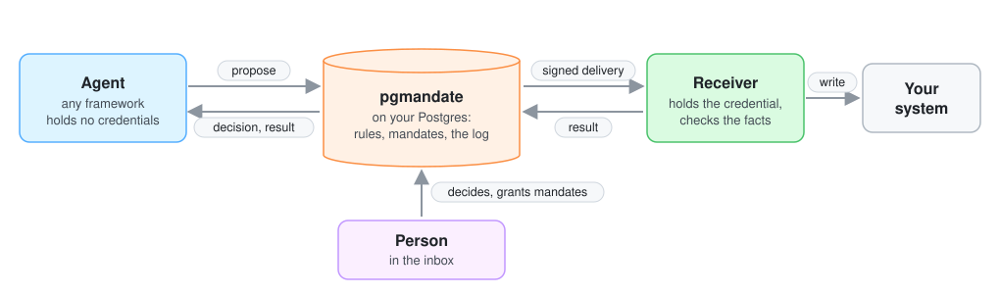
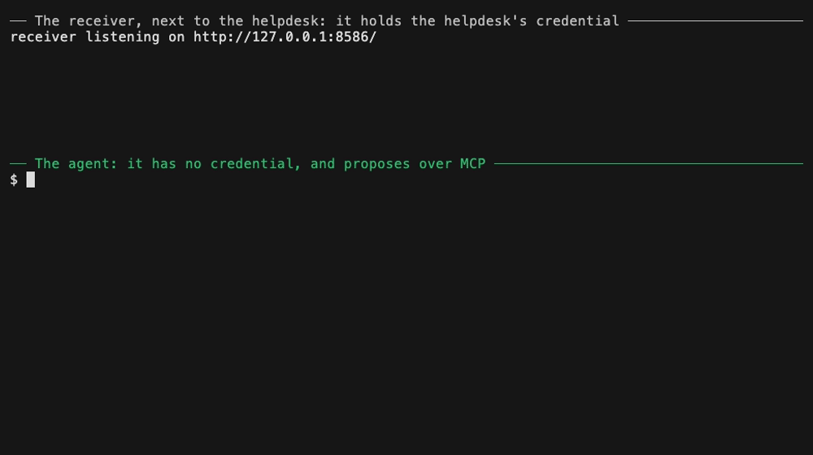

# pgmandate

**Agents propose. A person, or a standing permission a person granted, decides. The server checks the rules, and Postgres checks them again.**

pgmandate sits between your AI agents and the systems they change. An agent holds no credentials to those systems: it can only *propose* an action, such as a refund. A person approves it in an inbox, or a *mandate* that a person granted earlier allows it at once, within a budget, a risk limit and an end date. Only then is the action sent, signed, to a small *receiver* next to your system, which holds the credential and does the write. Every step is a row in your Postgres, which checks the rules again.

Think of pull requests for agent actions. A proposal is the pull request, a mandate is the branch rule that allows auto-merge, and the log is the history.



## See it

**A person decides.** A refund is high risk, so it waits in the inbox. Alice reads what pgmandate checked and, set apart, what the agent claims; she approves it with a note, and the receiver next to the helpdesk carries it out. Watch the end: the receiver's answer is kept with the decision.


**A mandate decides.** A ticket close waits, since no mandate covers it. Alice grants one: closes, up to medium risk, twenty a month, citing the section of her company's AI policy that allows it, and ticks that she is accountable for it. Watch the end: the agent's next close is carried out at once, and the decision names the mandate that allowed it.


**An agent, over MCP, and a webhook.** Below, an agent with no credential proposes over MCP. Above, the receiver next to the helpdesk, which holds the credential. The ticket is allowed under a mandate, so it arrives above as a signed webhook, and the receiver's answer comes back to the agent. The refund is high risk, so it waits for a person, and nothing arrives:



> **Status: early (0.1.0, Apache-2.0).** It runs, and it is tested against a real Postgres, including the rules with the service bypassed. It has no production users and no external security review. From 0.1.0 a database is upgraded, never reset; before 1.0 the APIs may still change, and a contract whose meaning changes gets a new version. Read [the threat model](docs/threat-model.md) before relying on it.

## How it works

- **A tenant** is an organisation. One server holds many, kept apart by row level security; its owners define actions and grant mandates, and its reviewers decide.
- **An action** is something an agent may ask to have done, such as `refunds.issue`. An owner defines it: a payload schema, a **risk** (low, medium or high), how long a proposal for it may wait, and where it is delivered.
- **A proposal** is one request by an agent: the action, the payload, and its *justification*: why, what it looked at, and which model it is. The justification is kept as written and shown to the person deciding as the agent's claim, never as a fact.
- **A decision** comes from a person in the inbox, or from a mandate. If nobody decides in time, the proposal **expires**: nothing is done, and the agent is told.
- **A mandate** is a person's standing permission for an agent. It names actions, up to a risk (high is never delegated), a **budget** of executions per month, a **policy reference** (the section of your own policy it rests on, recorded with every decision it allows), an end date, and optionally a **condition** on the payload in CEL, such as `payload.amount <= 200`. It is one row, and every decision it allows cites it.
- **A delivery** sends a decided proposal, signed with the server's Ed25519 key and addressed to the action's *audience*, to the action's **receiver**: a small service next to your system that holds the credential, checks the facts in the payload against its own records, and does the write. Its answer, *done*, *refused* or *unknown*, goes back to the agent.
- **The log** records every proposal, decision, delivery and refusal, in a chain of hashes that can be checked without the server.
- **A dry run** is how a team starts: a new agent keeps its own credential and proposes what it is about to do, and pgmandate records what a mandate would have allowed and what a person would have been asked, without carrying anything out.

Agents connect over MCP or as JSON over HTTP; people use the web UI or its API. It is one binary and one Postgres, on your machine, in your cloud or on-premise. The binary is published as a container image, `ghcr.io/andreas-lindfalk/pgmandate`, for amd64 and arm64, with the web app inside. A Go service can also embed it in its own process and database. [docs/design.md](docs/design.md) shows how the parts fit.

## Why Postgres

**Why a database at all.** The decision, the budget it spends, the delivery it records and the log event commit in one transaction, or not at all, so two servers cannot both spend the last of a budget. The rules hold on every path that writes, whether the server, a Go service that embeds pgmandate, or the command line, so a bug in the service cannot record what they refuse. The tests check this by writing to the database directly, past the Go code. And the record of who allowed what lives next to your data, in a database you already run, back up and audit.

**Why Postgres, and not MySQL, Spanner or SQLite.** The second gate is built from features that Postgres has together and the others lack:

- **Row level security.** Ten policies keep each tenant's rows apart from the server's own role, not only in its queries. MySQL and SQLite have no row level security.
- **Triggers that can refuse.** Twenty-four triggers in PL/pgSQL check each proposal, decision, mandate and log entry, and refuse with their own message. They read who is acting from a scope the transaction declares with `set_config`, which lasts for that transaction and no longer. Spanner has no triggers.
- **The payload rule, in the database.** A mandate's condition is kept as a plan in `jsonb`. Postgres checks the plan when the mandate is granted, and evaluates it on the payload actually executed.
- **The job queue in the same transaction.** Deliveries are jobs in [River](https://riverqueue.com), a queue built on Postgres, so a delivery's job commits with its decision or not at all.
- **It runs everywhere.** Every cloud offers it managed, setup needs no superuser, and it runs on-premise and in a test container, with no licence to buy.

So the store is not pluggable: the database as a second gate is the point. Nor is pgmandate a Postgres extension. It is a server that keeps its tables in schemas of their own, in a database of yours.

## What it protects against, and what it does not

It protects against mistakes: a bug in the service, an agent proposing outside its mandate, a decision made twice, and, as long as the receiver keeps its delivery ids and the deadline, a decision carried out twice or too late. It does not protect against:

- **A compromised server.** The database trusts the scope each transaction declares (tenant, actor, the proposal being executed). Whoever can run their own SQL as the server's role can declare any scope.
- **Whoever holds the signing key.** It can make any receiver act. It is kept out of the database, in your secret store.
- **The database owner,** who can change the rules and rebuild the log. Keep the log's latest hash somewhere else, and run the server without the owner's credentials, as [docs/running.md](docs/running.md#running-it) describes.
- **An agent that still has its credentials,** or one whose claims nobody checks. A condition decides on what the agent wrote; only the receiver can check it against the truth.

[docs/threat-model.md](docs/threat-model.md) lists what holds, where, and the known gaps.

## Is it for you?

It is for teams that let agents make consequential changes, such as refunds, account changes or messages that leave the company, in any language and with any framework. It is not a gateway, an identity provider, a policy engine or an agent framework; it works next to them. It governs changes, not reads, and suits consequential actions rather than a tight loop of small tool calls.

What it asks of you:

- **Take the agent's credentials away.** pgmandate means something only when the agent has no other way to act. That is an organisational change, not an install, and the dry run is how to get there.
- **A receiver per system.** It verifies the signature, does nothing twice, checks the facts and writes. [examples/refunds](examples/refunds) does this in about a hundred lines of Go, comments aside.
- **Ids, not personal data, in payloads.** Payloads are kept for the life of the tenant and cannot yet be erased one by one, so refunds, cancellations and other actions on ids make the best first pilot.
- **Budgets count executions, not amounts.** A condition limits each proposal, so a mandate that limits an amount needs a budget that bounds the sum. A budget in money is on the roadmap.
- **It fails closed.** When pgmandate is down, governed changes stop; plan a manual path.
- **Several instances on one database** are tested to hold decisions, budgets, limits and the log between them. There is no guidance yet for high availability.

[Piloting it](docs/scope.md#piloting-it) says what a team does, and when a pilot is done.

## Try it

### Watch the demo

```sh
make up      # Postgres on 127.0.0.1:5433    needs Docker
make demo    # the demo, in the terminal     needs Go 1.27
```

An agent proposes over MCP, as any MCP client would, and you see what happens to each proposal:
- a ticket goes through under a mandate and is delivered, signed;
- a close and a refund wait for a person;
- the budget runs out;
- a new agent in a dry run is recorded, and nothing is carried out;
- a proposal nobody decides expires;
- and Postgres refuses five changes that no rule allows, sent straight to the database over the server's own role, as the system, the tenant's owner and the agent.

It takes a little over a minute, and prints what it does as it goes: it is the protocol, step by step, for whoever wants to see it at work.

Then `make run` (it also needs Node 22 and pnpm 10) and open http://127.0.0.1:8585 as `alice@acme.example`: the inbox is as the demo left it. [docs/running.md](docs/running.md#the-demo-step-by-step) goes through it step by step.

### Run it with Docker only

This pulls the published image, `ghcr.io/andreas-lindfalk/pgmandate:latest`, and a Postgres:

```sh
git clone https://github.com/andreas-lindfalk/pgmandate && cd pgmandate
docker compose -f deploy/quickstart/compose.yaml up
```

Open the setup link the server prints, name your organisation and yourself, and you are its owner. Then, in the UI:

1. *Agents & actions*: register an agent, created live, and copy its token. Define an action such as `tickets.create`, delivered to `http://127.0.0.1:8586/`.
2. The page then shows the tenant and the audience a receiver needs. Start one inside the container with them: `docker compose -f deploy/quickstart/compose.yaml exec pgmandate /pgmandate receiver -tenant <tenant> -audience <audience>`.
3. *Mandates*: grant the agent one, or leave it out and decide each proposal yourself.
4. Connect the agent (next section), or propose with `curl` as in [docs/agents.md](docs/agents.md#connecting-an-agent), and watch the *Inbox*.

It listens on this machine only, and its passwords are fixed in the file: it is for trying pgmandate out, and CI walks the same path. [docs/running.md](docs/running.md) is how to run it for real.

## Connect an agent

An agent needs the MCP address and its token. In Claude Code:

```sh
claude mcp add --transport http pgmandate http://127.0.0.1:8585/mcp --header "Authorization: Bearer mnd_..."
```

The server tells the agent how to work with it: list the actions, propose with an idempotency key and its reasons, and read the outcome. `propose` answers at once, or within two seconds when a mandate allows it; a proposal that waits for a person is read again later with `get_proposal`. [docs/agents.md](docs/agents.md) has the rest: other MCP clients, the same contract as JSON over HTTP, limits, the dry run, and how a repeated call is recognised.

## Write a receiver

A receiver verifies the signature, accepts only its own audience and tenant, does nothing twice and nothing after the deadline. In Go, [examples/webhook](examples/webhook) does all of that, and what you write is the check of the facts, the write and the answer:

```go
const keysUrl = "https://pgmandate.example/.well-known/pgmandate-keys"
keys, err := sign.Fetch(ctx, http.DefaultClient, keysUrl)
if err != nil {
	log.Fatal(err)
}
receiver := webhook.NewReceiver(keys)
receiver.Refresh = func(ctx context.Context) (sign.KeySet, error) { return sign.Fetch(ctx, http.DefaultClient, keysUrl) } // after a rotation, and every five minutes so a dropped key is revoked
receiver.Trust(audience, tenantId) // what defining the action printed, never taken from the request
receiver.Handle = func(d webhook.Received) (any, error) {
	var refund Refund
	if err := json.Unmarshal(d.Payload.Proposal.Payload, &refund); err != nil {
		return nil, fmt.Errorf("%w: not a refund", webhook.ErrRefused)
	}
	order, ok := shop.Order(refund.OrderId) // the agent's claims, against your records
	if !ok || refund.AmountCents > order.Refundable() {
		return nil, fmt.Errorf("%w: the payload does not match the order", webhook.ErrRefused)
	}
	return shop.Refund(order, refund.AmountCents, d.DeliveryId) // done: the result is kept and shown to the agent
}
http.ListenAndServe(":8586", receiver)
```

Any language works: the contract is plain HTTPS, JSON and Ed25519, with a JSON Schema and a known answer to test against. [docs/receivers.md](docs/receivers.md) is the contract, step by step.

## Why not an API key and an approval step?

That works for one agent in one framework, but the agent still holds a key it could use without asking. Others close part of the gap:
- **Gateways** such as AWS's AgentCore Policy and the MCP gateways of TrueFoundry and Permit.io decide per call in front of the tool, and some let one approval cover the next minutes.
- **Governance libraries** such as Microsoft's Agent Governance Toolkit run policies, budgets and approvals inside the agent's own process.
- **Credential brokers** such as Auth0's Token Vault keep the key away from the agent.

A mandate is a different kind of permission: one row a named person granted, cited by every decision it allows, on a database the agent cannot reach, which enforces it again, conditions included. A condition that cannot be evaluated never allows. What pgmandate lacks is high availability and, today, a way in that needs no code. [docs/landscape.md](docs/landscape.md) sets out what others ship, as of November 2026.

## Documentation

| | |
|---|---|
| [docs/agents.md](docs/agents.md) | Connecting an agent, the contract, limits, the dry run, and doing it once |
| [docs/receivers.md](docs/receivers.md) | Writing a receiver: the delivery contract, step by step |
| [docs/running.md](docs/running.md) | The demo step by step, your own tenant from the command line, running it for real, the settings, managed Postgres, releasing |
| [examples/](examples/README.md) | A reference receiver, a refunds receiver that checks the agent's claims, and a Go service that embeds pgmandate |
| [docs/scope.md](docs/scope.md) | The canonical description: what it is and is not, [the terms](docs/scope.md#the-terms), the rules on the payload, where it fits, and [piloting it](docs/scope.md#piloting-it) |
| [docs/design.md](docs/design.md) | How the parts fit |
| [docs/threat-model.md](docs/threat-model.md) | The rules, what holds them, and what does not |
| [docs/roadmap.md](docs/roadmap.md) | What comes next |
| [docs/decisions.md](docs/decisions.md) | Why it is built this way, by date |

## Contributing

`modules/` holds the domain, `pkg/` the shared plumbing, `schema/` the migrations, `api/` the people's API, `modules/agentapi` the agent contract and `mcp/` its MCP door, and `web/` the UI. [AGENTS.md](AGENTS.md) has the conventions. Questions and pilots start with an issue; security reports go through [SECURITY.md](SECURITY.md).

Andreas Lindfalk. Apache-2.0, see [LICENSE](LICENSE).
