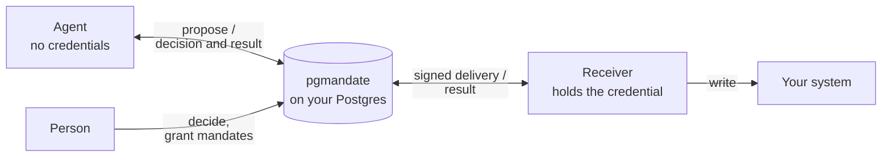

# pgmandate

**Agents propose. A person, or a standing permission a person granted, decides. Postgres enforces the rules a second time.**

Think of pull requests for agent actions. A proposal is the pull request. A mandate is the branch rule that allows auto-merge. The log is the history.

pgmandate is a write authority layer between AI agents and the systems they change. An agent holds no credentials to the systems it changes. It can only *propose* an action, such as a refund. Then one of two things decides:

- a **person** approves, edits or rejects the proposal in an inbox, notified in Slack or Discord when something waits, or
- a **mandate** that a person granted earlier allows it at once, and the decision records exactly which mandate, which policy, which risk limit and how much of the budget allowed it.



> **Status: early, a working demonstration (0.0.1, Apache-2.0).**
> - It runs, it is tested against a real Postgres, and the demo below shows the core loop.
> - It has no production users and no external security review.
> - Every system it protects needs a receiver written for it.
> - Nothing is kept compatible until 0.1.0: the schema and the delivery contract will change. Try it locally now, and [pilot on 0.1.0](docs/scope.md#piloting-it).
>
> Read [the threat model](docs/threat-model.md) before relying on it.

**Who it is for:** teams that let agents make consequential changes, such as refunds, account changes or messages that leave the company. Those teams must also be willing to:
- take the agents' credentials to those systems away
- run a small receiver next to each system
- run Postgres

The agent can be written in any language and use any framework.

**What it is not:** a gateway, an identity provider, a policy engine or an agent framework. It works next to those.

A mandate is data, not prompt text. For example, *this agent's refunds may be carried out without a person, at most 40 a month, under policy AI-POLICY-2026-01 §4, until March, when*

```
payload.amount <= 200 && payload.currency in ["EUR", "SEK"]
```

That rule on the payload is written in CEL, the expression language Kubernetes uses for its validation rules.
- It is checked against the actions' schemas when the mandate is granted.
- The service evaluates it to choose a mandate, and Postgres evaluates it again on the payload actually executed.
- Anything it cannot evaluate goes to a person. See [rules on the payload](docs/scope.md#rules-on-the-payload).

Each action has a risk its owner sets: low, medium or high. A mandate covers actions only up to the risk it names, and high risk always goes to a person. This example assumes refunds are defined as medium risk; in the demo below they are high, so they always wait. The budget of 40 counts executions: once 40 refunds have run this month, the rest wait for a person.

The decided proposal is delivered, signed, to a small receiver next to your system, which checks the facts it is given and does the write. What the receiver answers goes back to the agent.

Postgres checks the rules a second time, with row level security and triggers. As long as the service states each transaction's scope truthfully, a bug in it cannot record or allow what the rules refuse. The [threat model](docs/threat-model.md) lists the few rules only the service holds. Every proposal, decision, delivery and refusal is a row in a hash linked log. Anyone who keeps its latest hash outside the database can check it without the server. Each proposal also keeps the agent's justification as written: its rationale, its evidence and the model and version it came from. The record therefore shows what the person who decided was shown, not only who decided.

[docs/scope.md](docs/scope.md) is the canonical description: what pgmandate is and is not, where it fits, [how a pilot would look](docs/scope.md#piloting-it), and what it brings. [docs/roadmap.md](docs/roadmap.md) says what comes next.

**Why not give the agent an API key and an approval step in its framework?** That works for one agent in one framework, but the agent still holds a key it could use without asking. Gateways fix the key, and some let an approval cover the next minutes or exempt a trusted agent. A mandate is a different kind of permission. It carries a budget, a risk limit, a policy reference and an end date. It is a row that a named person granted, and Postgres checks it again on every decision it allows.

## Three doors

```
agents ──MCP──▶ propose ──▶ the record (Postgres)
                               │  a person decides, or a mandate allows
                               ▼
systems ◀──signed webhook── delivery ──result──▶ back to the agent

people ◀──web UI / API──▶ inbox, mandates, agents and actions, people, evidence
```

- **Agents** connect with a token, over MCP or as JSON over HTTP: one contract, `mandate.agent.v1`, with five calls: `list_actions`, `propose`, `get_proposal`, `list_proposals`, `withdraw_proposal`. Any MCP client works: Claude Code, an SDK, a script; so does anything that can POST JSON.
- **Systems** receive decided proposals at the webhook URL of each action, signed with the server's Ed25519 key and addressed to the action's audience. A receiver answers *done*, *refused* or *unknown*; anything else is retried until the delivery's deadline. One that never reached the receiver can be sent again, and one whose outcome is unknown is settled by a person.
- **People** sign in (OpenID Connect, or dev login on localhost). Reviewers decide in the inbox; owners also run the tenant: the inbox, the mandates with their budget, the agents and their tokens, the actions and their connectors, the people, and the evidence with exports.

One binary and one Postgres, on your own machine, in your cloud or on-premise. A Go service can also embed it and share its database (see [the scope](docs/scope.md#where-it-fits)). How the parts fit is in [docs/design.md](docs/design.md).

## What this requires, and what it is not for

- **The agent must have no other way to act.** pgmandate means something only if the credentials to the target system live with the receiver, not with the agent. Taking them away is the real work, and it is an organisational change, not an install.
- **Keep the agent away from the admin path.** Locally, dev login and the command line's `-as EMAIL` act as any person, and the default database password is in this repository. An agent with a shell on the same machine could approve its own proposals. Run the agent as another user or in a container, and run pgmandate for real (below) before an agent depends on it.
- **It governs changes, not reads.** An agent reads what it needs through its own tools. pgmandate does not see or limit that.
- **It suits consequential actions**: a refund, a message that leaves the company, a change to a record. It does not suit a tight loop of small tool calls.
- **It is not a compliance tool.** If you run a high-risk system under the EU AI Act, or an ISO/IEC 42001 management system, the log is the kind of record that supports human-oversight and logging controls: who approved, under which authority, and what was refused. Whether those duties apply to you, and whether this is enough, is for you and your auditor.

## Ten minutes, with only Docker

```sh
git clone https://github.com/andreas-lindfalk/pgmandate && cd pgmandate
docker compose -f deploy/quickstart/compose.yaml up        # pulls the published image; --build builds this clone instead
```

The server prints a setup link: `http://localhost:8585/setup#…`. Open it, name your organisation and yourself, and you are signed in as its owner. Then, in the UI:

1. *Agents & actions*: register an agent (tick *Live from the start*) and copy its token; define an action, such as `tickets.create`.
2. *Mandates*: grant the agent a mandate for it, or leave it out to decide each proposal yourself.
3. Connect the agent (below), or propose with `curl` as under *Connecting an agent*, and decide in the *Inbox*.

The link works once, for 30 minutes, and only while nothing is set up; a restart prints a new one. When your session runs out, get back in with a single-use link: `docker compose -f deploy/quickstart/compose.yaml exec pgmandate /pgmandate sign-in-link -tenant <id> -email <you>`. The quickstart is for trying pgmandate on your own machine: it listens on this machine only, and its database passwords are fixed in the file. *Running it* below is how to run it for real. `deploy/quickstart/smoke.sh` walks the same path through the APIs, and CI runs it.

## Five minutes, from the source

```sh
make up      # Postgres on 127.0.0.1:5433                       needs Docker
make demo    # the scripted demo, in the terminal               needs Go 1.27
make run     # the UI, the API and MCP on http://127.0.0.1:8585  also needs Node 22 and pnpm 10 (corepack enable)
```

`make demo` sets up a tenant, an owner, an agent, three webhook actions and a mandate, with a small receiver standing in for a helpdesk. The agent then proposes over MCP, exactly as any MCP client would. The demo prints twelve steps:

1. The setup: tenant, owner, agent, three actions, one mandate for `tickets.*` up to low risk with a budget of three executions a month.
2. The agent asks what it may do.
3. A ticket within the mandate is allowed at once, delivered with a signature the helpdesk verifies, and the helpdesk's answer comes back to the agent.
4. Closing a ticket is medium risk, above the mandate: it waits for a person, and the reason is recorded.
5. A ticket whose text matches a known attempt to steer a model is flagged, high risk, and waits.
6. A refund is high risk, and high risk is never delegated: it waits.
7. Two more tickets use up the budget; the next one waits. One delivery is made to fail once, to show the retry.
8. The owner approves one waiting proposal and rejects another.
9. A second agent, new and so in dry run, proposes over MCP: a mandate would allow one proposal, and nothing is delivered or spent; the owner dismisses the other.
10. Five statements that no rule allows are sent straight to Postgres, as the system, the owner and the agent. Each is refused, with the database's own message.
11. The log verifies.
12. The first decided proposal is shown as it is exported.

It ends with the commands for what to do next. In short:

- `make run`, open http://127.0.0.1:8585, sign in as `alice@acme.example`, and you are in the inbox the demo left behind.
- The demo's receiver stops with the demo. Start the one it prints (`go run ./cmd/pgmandate receiver ...`) in another terminal, so that what you approve has somewhere to land. Without it a delivery retries and then shows as not delivered, and you can send it again before its deadline.
- The token the demo prints connects your own agent (next section). Its budget is spent, so grant a new mandate in the UI to see proposals go through by themselves.

Each `make demo` adds another tenant with the same name; `make reset` starts clean.

## Connecting an agent

An agent needs the MCP address and its token, which is shown once when it is issued (in the UI under *Agents & actions*, or by `pgmandate agent create`). In Claude Code:

```sh
claude mcp add --transport http pgmandate http://127.0.0.1:8585/mcp --header "Authorization: Bearer mnd_..."
```

Any other MCP client takes the same in its configuration:

```json
{ "mcpServers": { "pgmandate": { "type": "http", "url": "http://127.0.0.1:8585/mcp",
    "headers": { "Authorization": "Bearer mnd_..." } } } }
```

The server tells the agent how to work with it. In short: call `list_actions`, then `propose` with an `idempotency_key` made from its run and step and a `rationale`, its account for the person who decides of what it found and why this action follows, with `evidence` the person can check (where it looked, an id to find it again, what it showed). The answer is `{"created", "repeat"?, "proposal": {…}}`, and the proposal's `outcome` and `next` say whether it was allowed, carried out, or waits for a person and why. This justification is kept with the proposal as written, shown in the inbox as the agent's claim, and named in the log by digest. A mandate never reads it. Each answer is both text for a model and structured content for code, and an error carries a code (`invalid_argument`, `conflict`, `permission_denied`, `not_found`, `rate_limited`, `unauthenticated`, `canceled`, `internal`). After `internal` or `canceled` a proposal may have been stored: the same call under the same key returns it.

The same contract is served as JSON over HTTP, for an agent or a script that does not speak MCP. It is defined in [proto/mandate/agent/v1/agent.proto](proto/mandate/agent/v1/agent.proto). Payloads, results and refusals travel as JSON text (`payloadJson`), so every digit of a number is kept; over MCP they are objects. Errors use the Connect codes, with `already_exists` for a key used for another request, `failed_precondition` for withdrawing what no longer waits, and `resource_exhausted` with the seconds to wait. Only an agent's token opens it: a person's session is refused.

```sh
curl -s http://127.0.0.1:8585/mandate.agent.v1.AgentService/Propose \
  -H "Authorization: Bearer mnd_..." -H "Content-Type: application/json" \
  -d '{"action":"tickets.create","title":"Printer jams","idempotencyKey":"run-7:1","runId":"run-7",
       "rationale":"Three reports from floor 3.","payloadJson":"{\"subject\":\"Printer jams\"}"}'
```

For whoever runs the agent:

- **Give each run a run id**, in the prompt or the task. Keys are made from it, and a run that reuses one gets the earlier run's answers. An agent given none takes `suggestedRunId` from `list_actions`.
- **Allow tool calls at least five seconds.** `propose` waits up to two seconds for a mandate's decision, and `get_proposal` can wait longer when asked; some clients give up sooner by default.
- An agent's calls are limited to five a second per token, over MCP and HTTP together, with bursts of thirty, in each server instance; its proposals to 30 a minute and 300 an hour unless an owner sets other limits, which the database holds across instances. An agent sees its limits in `list_actions`, and a refusal says when to try again.
- **Withdrawing.** An agent can take back its own waiting proposal with `withdraw_proposal`, as when it proposes a corrected version; a person then never approves both.
- **Notifications.** An owner can have a Slack or Discord channel told when a proposal waits for a person (in the UI under *People*, or `pgmandate notify set`). The message names the action, its risk, the agent and why it waits, and links to the inbox; nothing the agent wrote goes to the channel.

To try an action without an agent, propose from the command line, over MCP like any client:

```sh
go run ./cmd/pgmandate propose -token mnd_... -action tickets.create -title "Printer jams" -rationale "Three reports from floor 3." -payload '{"subject":"Printer jams"}'
```

It prints the answer and the run and key it used; the same `-run` and `-key` again is a repeat.

## Your own agent, your own system

From the repository, as the first owner:

```sh
make up && make migrate                    # Postgres, and the schema and the app role in it
go build -o pgmandate ./cmd/pgmandate      # the command line, as ./pgmandate in any terminal here

./pgmandate tenant create -name Acme -owner alice@acme.example -owner-name Alice
# tenant 7d0c…-…  (Acme)
# owner  …
T=<the tenant id it printed>

# What the agent may ask for, and where it goes. It prints the action's audience.
./pgmandate action define -tenant $T -as alice@acme.example -key tickets.create -risk low -may-execute \
  -url http://127.0.0.1:8586/ -schema '{"type":"object","required":["subject"],"properties":{"subject":{"type":"string"}}}'

./pgmandate agent create -tenant $T -as alice@acme.example -name helpdesk-bot -mode live   # prints the agent id and its token
./pgmandate grant -tenant $T -as alice@acme.example -agent <agent id> -actions 'tickets.*' -max-risk low -budget 20 -policy "AI policy v1"

make run                                   # then connect the agent as above
./pgmandate receiver -tenant $T -audience pgm:...   # in another terminal, once the server runs: your system, for now
```

Locally the server makes its signing key once, in `.local/signing-key`, and the receiver fetches its public half from the running server.

The agent's `tickets.create` proposals are now allowed and delivered, twenty a month; everything else waits in the inbox at http://127.0.0.1:8585. Without `-may-execute` a person always decides, and without `-agent` a mandate covers every agent of the tenant. `action define` sets the whole definition each time: a flag left out goes back to its default. Replace the receiver with your own (below).

`-mode live` makes the agent live at once. Without it a new agent starts in a **dry run**, which is how a team starts before it takes the agent's credential away:

- The agent keeps its own credential and goes on acting with it. It proposes what it is about to do, and every answer says `dryRun: true`. The answer that made the proposal tells it to do it itself, once; a repeat or a later read never asks it to act again.
- pgmandate records what a mandate would have allowed (*would allow*, with the basis) and what would have waited for a person. Nothing of a dry run is ever carried out: the database refuses to approve, execute or deliver one, to count it in a budget, or to let it open an embedded host's table. A waiting dry run sends no chat notice, and a person may only dismiss it.
- The inbox keeps waiting dry runs in a tab of their own, out of the queue a person works, and the log tags each of their events with `dryRun: true`. The decisions export leaves them out.
- An owner makes the agent live (`pgmandate agent mode -mode live`, or *Make live* in the UI) once the record shows what the mandates would do. Proposals made before keep what they were.

## Running it

One image, one Postgres. A one-off `migrate` container holds the database owner's credentials; the server connects only as the application role:

```sh
export MANDATE_APP_PASSWORD=$(openssl rand -hex 16) MANDATE_OWNER_PASSWORD=$(openssl rand -hex 16)
export MANDATE_SIGNING_KEY=$(openssl rand -base64 32)
export MANDATE_VERSION=v0.1.0                         # the release's tag, as `pgmandate version` reports it
export MANDATE_OIDC_ISSUER=... MANDATE_OIDC_CLIENT_ID=... MANDATE_OIDC_CLIENT_SECRET=...
docker compose -f deploy/compose.yaml -f deploy/compose.server.yaml up -d --build
```

Keep both passwords and the signing key, in an `.env` file next to the compose files or a secret store: the owner password is fixed when the database volume is first created, and each start of `migrate` sets the app role's password again. This stack has its own database volume, apart from the one `make up` uses. Nobody can sign in until the provider is set, since dev login answers only on loopback. A receiver on the same machine is `http://host.docker.internal:<port>` from inside the container, a private address that needs `MANDATE_ALLOW_PRIVATE_CONNECTORS=true`; on Linux the receiver must listen on `0.0.0.0` (`-addr 0.0.0.0:8586`) to be reached that way. Then create a tenant with its first owner:

```sh
docker compose -f deploy/compose.yaml -f deploy/compose.server.yaml run --rm \
  migrate tenant create -name "Acme" -owner alice@acme.example -owner-name Alice
```

The administrative commands act on the database as the application role, at the address and with the app password worked out from the owner connection, so they run where that connection is set: in the `migrate` service here.

From there the owner works in the UI. Locally the same command is `go run ./cmd/pgmandate tenant create ...`, and `go run ./cmd/pgmandate help` lists the rest.

| variable | meaning |
|---|---|
| `MANDATE_DATABASE_URL` | the owner connection, for `migrate`; defaults to the local Postgres |
| `MANDATE_APP_PASSWORD` | the password of the `mandate_app` role: given to the role `migrate` creates, and set on an existing one only when given. The default, `app`, is refused when the server listens beyond loopback |
| `MANDATE_CREATE_APP_ROLE` | default `true`: `migrate` creates `mandate_app` when it is missing. `false`: a DBA created it, and `migrate` only checks it. On Postgres 16 and later only whoever made a role may set its password, so leave `MANDATE_APP_PASSWORD` unset for a DBA's role |
| `MANDATE_REVOKE_PUBLIC_CREATE` | `true` revokes `CREATE` on the schema `public` from everyone. Off by default: Postgres 15 and later grant none, and a shared database may need it left alone |
| `MANDATE_OWNER_PASSWORD` | compose only: the database owner's password when its volume is first created, default `owner` |
| `MANDATE_AGENT_TOKEN` | the token `pgmandate propose` uses when `-token` is not given |
| `MANDATE_APP_DATABASE_URL` | connect as the app role directly. With it, and without the owner connection, `serve` does not migrate and never holds the owner's credentials. This is how to run it for real: `pgmandate migrate` as a separate step |
| `MANDATE_HTTP_ADDR` | where to listen, default `127.0.0.1:8585` |
| `MANDATE_PUBLIC_URL` | how the server is reached, for cookies and the sign-in redirect |
| `MANDATE_OIDC_ISSUER`, `MANDATE_OIDC_CLIENT_ID`, `MANDATE_OIDC_CLIENT_SECRET` | the sign-in provider. A person added by email is bound at their first sign-in to a tenant to the provider's identity for them, and from then on that identity, and no other with the same address, is them there |
| `MANDATE_OIDC_REDIRECT_URL` | default `<public url>/auth/oidc/callback` |
| `MANDATE_DEV_LOGIN` | `true` lets anyone sign in with an email. Refused unless the server listens on loopback, and then it answers only to requests for localhost |
| `MANDATE_SESSION_TTL` | default `168h` |
| `MANDATE_CLIENT_IP_HEADER` | the header a trusted reverse proxy writes the client's address in, such as `X-Forwarded-For` (its last entry is used). Failed sign-ins and token checks are limited to twenty a minute per client address; without this header, behind a proxy every client shares the proxy's address and so one limit. Set it only when the proxy overwrites the header |
| `MANDATE_ALLOW_PRIVATE_CONNECTORS` | `true` lets webhook connectors live on local and private addresses, for development and for an on-premise install. Off, a delivery to such an address is never sent, and ends *not sent* |
| `MANDATE_SIGNING_KEY` | the Ed25519 seed deliveries are signed with, 32 bytes in standard base64 (`openssl rand -base64 32`). Never stored in the database. Required unless the server listens only on loopback, where one is made once in `.local/signing-key` |
| `MANDATE_SIGNING_KEY_FILE` | the same, read from a file |
| `MANDATE_SIGNING_KEY_CREATE` | `true` makes the file named by `MANDATE_SIGNING_KEY_FILE` once, when it does not exist, with a new key readable only by its owner, as the quickstart does. Without it a missing file stops the server, so a mistyped path never makes a key receivers do not trust |
| `MANDATE_SIGNING_KEYS_PREVIOUS` | comma separated public keys, in standard base64, that are still published but no longer sign: how a key is rotated |
| `MANDATE_RECEIVER_ADDR` | where `pgmandate receiver` and the demo's receiver listen, default `127.0.0.1:8586` |

### On a managed Postgres

RDS, Aurora, Cloud SQL, AlloyDB, Azure, Supabase and Neon give you an admin role that is no superuser. Point `MANDATE_DATABASE_URL` at that admin, in a database it owns or may create in, and run `pgmandate migrate`. It creates `mandate_app` without the attributes only a superuser may set, or uses one a DBA made beforehand (`MANDATE_CREATE_APP_ROLE=false`). The admin owns the tables; the server connects as `mandate_app` only (`MANDATE_APP_DATABASE_URL`).

`migrate`, and `serve` when it starts, refuse to go on when `mandate_app` could get past the rules: when it may set `session_replication_role`, or is, or through membership can act as, a role that is a superuser, bypasses row level security, creates roles, replicates, is the service's admin (`rds_superuser`, `cloudsqlsuperuser`, `azure_pg_admin` and the like), is one of Postgres's own roles with the server's files or every table (`pg_execute_server_program`, `pg_read_all_data` and the like), or owns pgmandate's schemas or tables. The error says which. Each of these gets past row level security or the append-only guard, and a role a DBA set up for convenience often has one. `migrate` also warns when the role may create objects in the schema `public`.

## Releasing

Push a tag, or publish a release on GitHub with a new tag:

```sh
git tag v0.1.0 && git push origin v0.1.0
```

The `release` workflow builds the image for amd64 and arm64 and publishes it as `ghcr.io/andreas-lindfalk/pgmandate:v0.1.0` and `:latest`, reporting `v0.1.0` as its version. The package takes the public repository's visibility, so anyone can pull it; its settings are under your profile's *Packages* tab, *pgmandate*, *Package settings*.

## Writing a receiver

A decided proposal is posted to its action's URL, under delivery contract v2:

```
POST <url>
Content-Type: application/json
User-Agent: pgmandate
Mandate-Delivery-Id: <uuid>
Mandate-Timestamp: <unix seconds, by the database's clock>
Mandate-Signature: v2 kid=<key id> sig=<standard base64 Ed25519 signature>

{ "version": 2, "kind": "delivery", "audience", "tenantId", "deliveryId", "correlationId", "createdAt", "notAfter",
  "proposal": { "id", "action", "title", "payload", "risk", "agentId", "runId"?, "proposedAt" },
  "decision": { "status": "approved" | "executed", "decidedAt", "edited", "decidedBy"?, "note"?, "executionBasis"? } }
```

The body is described field by field in [docs/delivery-v2.schema.json](docs/delivery-v2.schema.json), a JSON Schema to validate against or generate types from in any language. A test holds the server to it. A receiver is configured with two things, neither of them secret: the action's **audience**, which `action define` prints and the UI shows, with its tenant id; and the **keys** it trusts, fetched from `<server>/.well-known/pgmandate-keys` or given by hand. It does these in order:

1. **Verify the signature** over the raw bytes, before parsing anything. The signed bytes are `pgmandate-v2.`, the timestamp header's digits, a `.`, and the raw body as received; the signature is Ed25519 with the public key whose id is `kid`. Read the raw body, not a parsed one: `express.raw({ type: "application/json" })` in Express, `request.get_data()` in Flask. Refuse a key id you do not trust, and a timestamp more than five minutes from your clock. Answer 401 for a signature you cannot verify. In Go, `sign.Verify` does all of it, and `sign.Fetch` reads the published set.
2. **Check it is for you.** `kind` is `delivery`, `audience` and `tenantId` are the ones you were configured with (never taken from the request), and `deliveryId` equals the header's. Otherwise do nothing and answer 403 without an outcome, so it is retried: an action just moved to you has a new audience you may not have been given yet. In Go, `sign.CheckEnvelope`.
3. **Claim the delivery id, atomically.** A delivery you finished before is answered exactly as then. One still in progress is answered 503, which is retried. Keep the ids where a restart cannot lose them, until at least `notAfter` plus five minutes.
4. **Refuse what comes too late.** A delivery you never started that arrives after `notAfter` by your clock is answered `{"outcome":"refused","refusal":{"reason":"too_late"}}`, and nothing is done.
5. **Check the facts and act, and never commit after `notAfter`.** Abort work still under way at `notAfter`; answer `refused` if you are sure nothing took effect, and `unknown` if you are not.
6. **Answer explicitly**, with a JSON object of at most 4 kB, within 15 seconds:

| Answer | What pgmandate records |
|---|---|
| 2xx `{"outcome":"done","result":{…}}` | done. The result is kept and shown to the agent, so return what it needs, such as the id of what you created |
| any status `{"outcome":"refused","refusal":{…}}` | refused: you did nothing, and that is final. A refusal is always this shape |
| 2xx `{"outcome":"unknown","reason":"…"}` | unknown: you cannot tell, as when your own call timed out. A person settles it |
| anything else: other bodies, redirects (never followed), other 4xx, 5xx, a timeout | nothing final: retried, up to eight attempts and never later than `notAfter` minus 15 seconds |

A proxy's 404 is never read as a refusal. When the attempts run out, a delivery that was possibly sent becomes *unknown*, and one that provably never reached you (it failed before its headers were written) becomes *not sent*. A person may send a delivery that was never sent again, with the same delivery id, until `notAfter` minus 15 seconds. A person settles an unknown one as done or not done, but only from `notAfter` plus 15 seconds plus five minutes, when you can no longer carry it out. After a refusal, or one settled as not done, the agent may propose the same thing again under a new key.

- **Check your verification against a known answer.** The seed `AAECAwQFBgcICQoLDA0ODxAREhMUFRYXGBkaGxwdHh8=` has the public key `A6EHv/POEL4dcN0Y50vAmWfk1jCbpQ1fHdyGZBJVMbg=` and the key id `56475aa75463474c` (the first 16 hex digits of the SHA-256 of the public key). With the timestamp `1767225600` and the body `{"version":2,"kind":"delivery","deliveryId":"00000000-0000-0000-0000-000000000001"}` it gives `v2 kid=56475aa75463474c sig=RQk5h/yRhlTstIABLiW11fXXFg/5FmlDJtWnmdagCNPieC5C5ZCfUVsT9eXzRY9JlMdqEz1R0g3MLLC7gergCQ==`.
- **Keys and rotation.** The published set holds the key that signs and any previous ones still trusted. A fetched set replaces what you cached; it never adds to it, so dropping a key from the set revokes it. Fetch it over https from an address you were configured with. When the server starts signing with a new key, a receiver that has not fetched it answers 401 and the attempt is retried, so fetch the set again when you meet a key id you do not know (at most once a minute).
- **The audience changes** when an action is defined, defined again after removal, or moved to a new URL, so an audience never repeats. Deliveries still waiting, and never possibly sent, move to the new URL and audience; the receiver at the old one gets nothing more, apart from an attempt already under way. A receiver that serves several actions trusts each audience.
- **Check the version.** A field can be added within a version, so ignore fields you do not know. A removed field or a changed meaning is a new version: refuse a version you do not know.
- **Log the correlation id.** It is the run id the agent gave when it proposed, otherwise the proposal's id, so the agent's logs, pgmandate's log and yours can be joined on one value. A run id is the agent's own word: use it to group, and use `proposal.id` and `agentId` to identify.
- **Times** are RFC 3339 in UTC. The body is the same on every attempt for one audience; the time of an attempt is the `Mandate-Timestamp` header.
- **Act only on** `decision.status` `approved` or `executed`.
- **Plain http only on private addresses.** Unless the operator allows local and private connectors, a connector must be `https`.
- **No ordering.** Two deliveries from the same agent may arrive in either order.
- **The payload fits the action's schema** as the schema was when the decision was made. If the schema changed after the agent proposed and the payload no longer fits, an approval needs an edit that fits and a mandate does not allow it.
- Fields marked `?` are left out when empty: `runId` when the agent gave none, `decidedBy` for an execution, `executionBasis` for an approval.

`examples/webhook` is a reference handler to mount in your own server, and `pgmandate receiver` runs it locally.

**Check the claims before you act.** The payload is what the agent says, and a mandate's condition decides on what the agent says: `payload.daysSinceDelivery <= 14` is true when the agent wrote 3, whatever the order shows. For an action that moves value, read every fact the payload states from your own records, answer `refused` when one does not match (nothing happens, the delivery is not retried, and a person sees your answer), and carry it out once per proposal. [examples/refunds](examples/refunds/refunds.go) does that for a refund.

## Doing it once

Agents repeat themselves: a tool call times out and is sent again, or a model is not sure a step went through. Each hop has one name for the work, so a repeat is recognised and nothing is done twice.

| Hop | Name | What a repeat gets |
|---|---|---|
| Agent to pgmandate | `idempotency_key`, required on every `propose`, unique per agent | The first proposal, as it stands now: waiting, decided, delivered, with its result. `created` is false |
| Proposal to decision | The proposal's id | A proposal is decided once. A second approval, rejection or execution is refused |
| pgmandate to receiver | `deliveryId`, one per proposal, the same on every attempt | The receiver's first answer, if the receiver remembers the id |

- **No key, no proposal.** The table refuses a proposal without one, not only the service. A key is 1 to 200 printable ASCII characters without spaces, such as `run-9:step-3`.
- **The key names one request.** The same key with another action or payload is refused, so a reused key cannot quietly return an old answer to a new question. What was asked for is kept as a hash, so the repeat is still recognised after a person has edited the proposal, and after the action has changed or been removed.
- **Keys are the agent's to choose, and used once per agent, ever.** Its host should give each run a run id to make them from; `list_actions` offers `suggestedRunId` to an agent given none. Make them from the work, such as the run id and the step, and reuse them only for a retry of the same request. A key that comes back next week, such as `weekly-report`, returns last week's proposal: the answer then says `repeat: true` and that nothing new was done. An agent that makes up a new key for a retry has made a new request, and pgmandate cannot tell; the budget and the person are what is left then.
- **The receiver must remember delivery ids durably.** Use the id as the idempotency key of whatever you call next, or store it in the same transaction as the work. `examples/webhook` keeps them in memory, which is enough for a demonstration and not for a restart.

## The rules, in one place

- A proposal is allowed without a person only if **all** of these hold: the action is defined as one that can be delegated, a person granted a mandate that is live now and covers the agent and the action, the proposal's risk is within the mandate, the mandate's condition, if it has one, is true for the payload, nothing was flagged, and the mandate has room left in its count for the month. The agent and the inbox are told which one failed.
- A mandate allows low or medium risk. High is never delegated. A person's edit is assessed again and can only raise the risk.
- The action as it is when the decision is made counts. A proposal whose payload no longer fits the action's schema, or whose action's risk was raised since it was proposed, waits for a person, who approves it at the action's current risk or edits it to fit.
- A delivery is recorded in the transaction that makes the decision, and only to the action's own connector. The log names the payload that was proposed, the one decided on and the body that was sent, as digests.
- Only a person decides. Only an owner grants mandates, defines actions and adds or removes people. Only the system allows under a mandate, and only inside the transaction that names the proposal, with a basis the database checks against the mandate: coverage, risk limit, condition, policy reference, budget and this month's spend.
- The log is append-only and hash linked per tenant, and each event carries the actor of its session. It is **tamper-evident, not tamper-proof**: an edit, a removal or a forged actor by the application is refused or detectable, and an export verifies offline, but someone who owns the database could rebuild it. Keep the latest hash somewhere the database owner cannot reach.
- The check for steering text is a **tripwire**, a few known English phrasings. It is not a control and will miss most real attempts. The controls are the action's schema and risk, the mandate, and the person.

- Every proposal carries the agent's rationale, kept as written and never edited. It informs the person deciding; it is the agent's claim, not a checked fact.
- An agent may make only so many proposals a minute and an hour; the database refuses the rest.

What the database enforces, what only the service enforces, and what neither does, is spelled out in [docs/threat-model.md](docs/threat-model.md). The triggers in [schema/](schema/) are the authoritative text.

## Glossary

The terms follow [docs/scope.md](docs/scope.md#the-terms).

| Term | Meaning | Elsewhere called |
|---|---|---|
| Action | Something an agent may ask to have done, such as `tickets.create`, with a payload schema (required for a webhook), a risk, and how long a proposal for it may wait | Tool call, operation |
| Proposal | One request by an agent to have an action carried out, with its justification: rationale, evidence and provenance | Approval request, human in the loop |
| Condition | A CEL expression on the payload that narrows a mandate, such as `payload.amount <= 500`; the database evaluates it again | Policy rule, guard |
| Mandate | A person's standing permission for an agent: which actions, up to which risk, within which budget, under which policy reference, until when | Delegation, standing authorisation |
| Budget | How many executions a mandate may allow per calendar month. Money as a second limit is on the [roadmap](docs/roadmap.md) | Spend limit |
| Expiry | A proposal nobody decides before its action's waiting time is up expires: nothing is done, and the agent is told | Timeout |
| Policy reference | The name of the document a mandate rests on, recorded with every decision it allows. The document is not stored or checked | Policy |
| Execution basis | What allowed a proposal without a person: the mandate, its policy reference, its risk limit, its condition and the budget at that moment | Authorisation record |
| Connector, receiver | Where a decided proposal is sent to be carried out: a signed webhook address, and the service that answers there next to your system | Integration, webhook target |
| Delivery | One decided proposal on its way to a connector, with its attempts and the result | Webhook delivery |
| Log | The append-only, hash linked record of everything that happened in a tenant. The UI calls it the audit trail and shows it on the Evidence page | Audit log, audit trail, chain |
| Run | The agent's own id for one piece of work, which groups its proposals | Task, session |
| Tenant, owner, reviewer | The organisation; a person who grants, defines and decides; a person who decides | Organisation, admin, approver |

The word is used elsewhere too: Google's Agent Payments Protocol calls its signed payment authorisations mandates, and an IETF draft describes agent mandates across domains. pgmandate is unrelated to both: its mandates cover any action, and they are rows in Postgres, not signed credentials.

## How it compares

Keeping credentials away from agents and asking a person before risky calls is, by late 2026, a common pattern. What others ship, as far as their own documentation says in November 2026:

- **Cloud agent platforms.** [Policy in Amazon Bedrock AgentCore](https://aws.amazon.com/about-aws/whats-new/2026/03/policy-amazon-bedrock-agentcore-generally-available) (generally available since March 2026) applies Cedar policies, conditions on a call's arguments included, at the gateway between agent and tool. DigitalOcean's [Action Gateway](https://docs.digitalocean.com/products/managed-agents/action-gateway/concepts/tool-policies/) (preview) decides allow, ask or deny per tool and keeps the credentials.
- **MCP gateways.** TrueFoundry and Permit.io's MCP gateway ask a person before a tool call, and can let an approval cover a time window or exempt a trusted agent. LangSmith's [Tool Gateway](https://docs.langchain.com/langsmith/tool-gateway-policies) (beta, November 2026) blocks a call or asks the caller to approve it. Docker's MCP gateway can require an in-session confirmation through its sandbox policies. Kong's MCP proxy and Enkrypt's gateway apply allow and deny rules and guardrails.
- **Governance libraries.** Microsoft's [Agent Governance Toolkit](https://opensource.microsoft.com/blog/2026/04/02/introducing-the-agent-governance-toolkit/) (MIT, April 2026) runs policies in the agent's process, with approvals, spend limits and a chained audit log.
- **Approval layers of the same kind.** SidClaw wraps an MCP server with policy, approval and a hash-chained audit. Countersign ("the model proposes, deterministic code disposes") is a reference implementation with a hash-chained audit and two approvers for high risk. OpenLeash lets owners set policies that agents ask under, and lets agents propose new policies.
- **Credential brokers**, such as Infisical Agent Vault (in preview) and Auth0's Token Vault with asynchronous authorisation, hold the secret and inject it, so the agent never sees it.
- **Identity platforms**, such as Microsoft Entra Agent ID with Agent 365, and Okta, give agents an identity, an owner and access reviews.
- **Agent frameworks** have approval steps inside one run.

Most of these decide on a call's arguments too, several with richer languages than pgmandate's comparisons. What pgmandate does differently, as far as we have found: a standing grant is one row a named person granted, with a budget, a risk limit, a policy reference and an end date; a decision is a row that names the authority it rests on; and Postgres enforces the rules again, conditions included, so a bug in the service cannot allow what they refuse, and a condition that cannot be evaluated never allows. What it lacks: production users, high availability and, today, a way in that needs no code. A receiver has to be written for each system; templates in more languages and a bridge that makes an existing MCP server a receiver without code are on the [roadmap](docs/roadmap.md). [docs/landscape.md](docs/landscape.md) sets this out by category.

## Layout

`modules/` holds the domain, `pkg/` the shared plumbing, `schema/` the migrations, `api/` the people's API, `modules/agentapi` the agent contract and `mcp/` its MCP door, `web/` the UI, `examples/` a receiver, a refunds receiver that checks the claims it is given, and an embedded host. [AGENTS.md](AGENTS.md) has the conventions; [docs/decisions.md](docs/decisions.md) has the reasoning.

## Author

Andreas Lindfalk.

## License

Apache-2.0. See [LICENSE](LICENSE). Security reports: [SECURITY.md](SECURITY.md).
