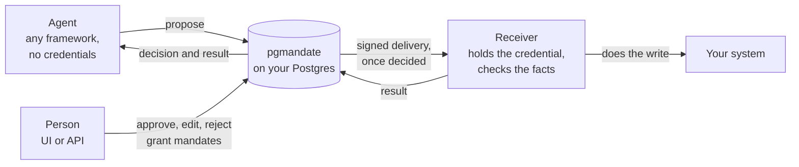
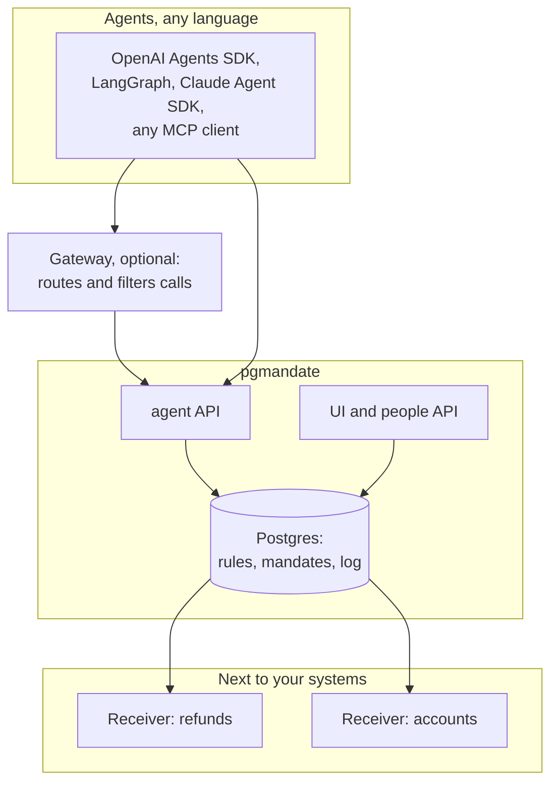

# Scope

This document says what pgmandate is and is not, where it fits, what it brings and why it is built this way. It is the canonical description. When the README, another document, the UI or a help text says otherwise, one of them is wrong, and the fix goes in the same change that finds it.

Elsewhere:
- what comes next: [roadmap.md](roadmap.md)
- how the parts work: [design.md](design.md)
- what holds and what does not: [threat-model.md](threat-model.md)
- the reasoning behind each choice: [decisions.md](decisions.md)

## The problem

AI agents have started to change things. They refund orders, change customers' accounts, send messages out of the company and edit records. The usual setup gives the agent a credential and has its framework ask a person before some tool calls. That leaves three gaps:

- **The agent holds a key it could use without asking.** The approval step is a convention kept by the agent's own code, not a boundary.
- **Permission is granted one call at a time.** There is no way to say *this agent may refund damaged goods up to €200 each, at most 40 times a month, under our refund policy, until March*, have a named person grant it, and have it counted. So a person either approves every call, and soon approves without reading, or the step is turned off.
- **The record is scattered.** What was allowed, by whom and under which authority sits in each framework's logs, if anywhere.

## What pgmandate is

**pgmandate is a write authority layer between AI agents and the systems they change. Agents propose actions. A person decides, or a mandate a person granted decides. Postgres enforces the rules a second time and keeps the record.**

Think of pull requests for agent actions. A proposal is the pull request. A mandate is the branch rule that allows auto-merge. The log is the history.



It consists of three things:

1. **A Postgres schema** of tables, row level security, triggers and SQL functions. It holds the rules and checks them again on every path through the service. [threat-model.md](threat-model.md) lists which rules only the service holds.
2. **A Go service** around the schema, with:
   - an API for agents (MCP)
   - an API for people (Connect, JSON over HTTP)
   - a web UI built on that API
   - a notice to a Slack or Discord channel when something waits for a person
   - a worker that delivers decisions
3. **A delivery contract**: webhooks signed with a key pair, addressed to one receiver by an audience, with a versioned JSON schema ([delivery-v2](delivery-v2.schema.json)), an id per delivery, a deadline, and an explicit answer: done, refused or unknown. A *receiver* is a small service next to the system it changes. It holds that system's credential, checks the facts in the payload against its own records, and does the write.

### Rules on the payload

A mandate can say more than "this agent may issue refunds". It can carry a rule on what each proposal contains, and then allows only proposals that meet it:

```
payload.amount <= 200 && payload.currency in ["EUR", "SEK"] && payload.reason == "damaged"
```

- **Written in CEL,** the expression language Kubernetes uses for its validation and admission rules, so many engineers already read it. pgmandate accepts the part of CEL that the database can evaluate too: payload fields and the action's key compared with literal values, `in` a list, and `has()`, combined with `&&`, `||` and `!`.
- **Checked when it is granted.** It is checked against the schemas of the actions the mandate covers. The grant is refused for a field no action declares, or a literal of a type the field never has. An action without a schema accepts any field, so for it nothing can be checked.
- **Evaluated twice, from one compiled plan.** The service evaluates it to choose a mandate, and Postgres evaluates it again on the payload actually executed. A test keeps the two in step.
- **Exact.** Numbers compare as decimals, so `0.1` is `0.1` and `500` equals `500.0`.
- **Unknown never allows.** A missing field, a value of another type, or anything else that cannot be evaluated leaves the proposal to a person.
- **Explained.** When a rule stops a proposal, the inbox and the agent are told which comparison failed and what the payload had instead.

A rule decides on what the agent wrote. Checking that against the facts is the receiver's job (see [What it requires of you](#what-it-requires-of-you)). A rule limits each proposal; the budget limits their sum over a month.

### Nobody watches the inbox

When a proposal waits for a person, pgmandate tells the people and the agent; nobody has to keep checking.

- **People are notified.** An owner sets a Slack or Discord channel for the tenant, and each proposal that waits for a person is posted there once, with a link to it in the inbox. The post names:
  - the action and its risk
  - the agent's registered name
  - why the proposal waits

  The post carries nothing the agent wrote, so a proposal cannot post text into the chat or put personal data into the chat tool. The decision itself is made in the inbox, where the person sees the payload and the justification.
- **The agent learns the outcome.** `get_proposal` can wait for the decision and the delivery's result, so an agent does not poll in a tight loop.

More channels and a callback to the agent's host are in the [roadmap](roadmap.md).

### The agent's justification, kept with the decision

Every proposal carries the agent's justification. The rationale is required, as the idempotency key is; the evidence and the provenance are optional. The three parts are:
- **the rationale**: what it was asked, what it found, and why this action follows
- **the evidence**: what it looked at, with an id or a query that finds each item again
- **the provenance**: the client, the model and the agent's own version, as the agent states them

The person deciding reads the justification beside the payload. Afterwards the record holds not only who decided under which authority, but also what that person was shown and the reasoning they acted on:

- **Kept as written.** No update can change the justification, a person's included. A person's view goes in the decision note.
- **In the log by digest.** The proposal's event in the log holds:
  - the digests of the rationale and the evidence
  - the provenance labels
  - the digest of the action's schema the proposal was made against

  So the log shows which agent version, which model and which version of the action were involved, and a later change to the text would show.
- **Useful after the fact.** It serves an auditor asking why something was approved, and a post-mortem of a mistake. It can also be used to evaluate agents over time: which model and version proposed what, and how often people agreed with it unedited.

It is the agent's claim, not a checked fact, and it is only as good as the agent that writes it. A model can fill it with boilerplate, and the person deciding will see that too. A mandate never relies on it, and a steering-text flag in it can only stop a mandate. Two cautions follow from keeping it:
- It is untrusted text in front of the person who decides, and is shown as the agent's.
- It cannot be erased one by one. Agents are told to refer to people by id and to keep personal data out (see [Data it keeps](#data-it-keeps)).

### The terms

The code, the UI and the documents use these words. The README's glossary follows this list.

| Term | Meaning |
|---|---|
| **Action** | Something an agent may ask to have done, such as `refunds.issue`. It has a risk, how long a proposal for it may wait, a payload schema (required for a webhook) and a connector, or, in an embedded host, code. Actions are data an owner defines. |
| **Proposal** | One request by an agent to have an action carried out. It carries the payload, an idempotency key and the agent's *justification*. |
| **Justification** | Three parts, each the agent's claim and not a checked fact: its *rationale* (why), its *evidence* (what it looked at), and its *provenance* (the client, model and version it says it is). |
| **Risk** | Low, medium or high, set on each action by an owner. A mandate covers actions up to low or medium risk. High risk always goes to a person. |
| **Flagged** | A proposal whose text matches a known prompt injection phrasing. A flag keeps a mandate from allowing it. It is a tripwire, not a control. |
| **Mandate** | A person's standing permission for an agent. It sets which actions, up to which risk, under which condition on the payload, within which budget, resting on which policy reference, and until when. It is a row a named person granted. |
| **Condition** | An expression on the payload that narrows a mandate, such as `payload.amount <= 200`. It is written in a subset of CEL (see [Rules on the payload](#rules-on-the-payload) and [design](design.md#conditions)). The service and the database evaluate the same compiled plan. |
| **Budget** | How many executions a mandate may allow per UTC calendar month. An amount of money as a second limit beside the count is planned ([roadmap](roadmap.md)). |
| **Policy reference** | The name of the document a mandate rests on, such as `AI-POLICY-2026-01 §4`. It is recorded with every decision the mandate allows. pgmandate neither stores nor checks the document. |
| **Decision** | A person's approval, edit or rejection, or a mandate's allowance. An allowance records its *basis*: the mandate, the policy reference, the risk limit, the condition and the budget at that moment. |
| **Connector, receiver** | Where a decision goes to be carried out. The connector is the signed webhook address defined on the action. The receiver is the service that answers there. A Go service that embeds pgmandate can instead carry an action out in its own code, in the same database transaction that decides it (a *builtin* action). |
| **Delivery** | One decided proposal on its way to a receiver, with its attempts and the result. |
| **Run** | The agent's own id for one piece of work. It groups the agent's proposals and makes its idempotency keys. |
| **Log** | The append-only, hash linked record of everything that happened in a tenant. It can be verified without the server. The UI calls it the audit trail and shows it, with its exports, on the Evidence page; the hash linked export is called the chain. |
| **Tenant, owner, reviewer** | The organisation. A person who defines actions, grants mandates and decides. A person who only decides. |

The project was first called *mandate*, and that name stays in identifiers on the wire and in the database: `MANDATE_*` variables, `Mandate-*` headers, the `mandate.v1` API, and the `mandate` schema and roles. In prose it is pgmandate.

## What it is not

- **Not a gateway or a proxy.** It does not intercept tool calls, route traffic or cache answers. Gateways such as agentgateway, Amazon Bedrock AgentCore Gateway or an MCP gateway do that, and many hold the tool's credential too. pgmandate is where a change that matters goes to be decided, with or without a gateway in front.
- **Not an identity provider.** People sign in through your OpenID Connect provider. An agent's token identifies it to pgmandate and nothing else.
- **Not a general policy engine.** Conditions are kept to what the database can also evaluate. Cedar, OPA or Cerbos can keep deciding access where you use them.
- **Not an agent framework, orchestrator or workflow engine.** It does not run agents, hold their memory or drive business processes.
- **Not for reads, or for high-volume calls.** An agent reads through its own tools, and pgmandate neither sees nor limits that. It suits consequential changes, where a decision is worth a row.
- **Not a compliance product.** The log is the kind of record that supports human oversight and logging controls, such as EU AI Act articles 12, 14 and 26 or ISO/IEC 42001. Whether those duties apply to you, and whether this is enough, is for you and your auditor.

## Principles

These hold in every version. A change that breaks one is a bug or a decision recorded in [decisions.md](decisions.md).

1. **AI changes nothing a person has not approved**, either the proposal or the mandate that allows it. The one exception is a dry run, planned as the way in for a new team. In a dry run, the agent still holds its credential and acts with it, and pgmandate only records what it would have decided. Nothing is governed then, and the record says so.
2. **The database checks again.** Postgres checks the rules again with policies and triggers. The [threat model](threat-model.md) lists the few rules that only the service holds. Every transaction states its scope: the tenant, who is acting, and which proposal is being executed. As long as the service states that truthfully, a bug in it cannot record or allow what the database's rules refuse. The threat model also says what a service that misstates it could do.
3. **Unknown never allows.** These all leave the decision to a person:
   - a condition that cannot be evaluated
   - a missing field, or one of another type
   - an action changed since it was proposed in a way that matters: a payload that no longer fits its schema, or a webhook action's raised risk
4. **The payload decided is the payload delivered.** The log names, by digest, the payload proposed, the payload decided and the body delivered. The service writes those digests; the threat model says which parts of the log the database itself checks. The destination is the action's connector at the time of delivery, and a move of it is logged.
5. **Agents and deliveries are done once.**
   - Every proposal carries the agent's idempotency key.
   - Every delivery carries an id a receiver deduplicates on.
   - The people API has no such key yet (see the threat model).
6. **The agent's text is untrusted.** Its justification is shown to a person as the agent's claim. It can stop a mandate, through a flag, but never enable one. It is never sent to a chat channel.
7. **Every decision names its authority**, in a hash linked log. Anyone who keeps the latest hash outside the database can detect a change to it. The database's owner could rebuild it, and the threat model says so.

## What it requires of you

pgmandate means something only when these hold. The software cannot make them hold.

- **The agent has no other way to act.** The credentials to the target system live with the receiver, not with the agent. Taking them away is the real work. It is an organisational change, not an install.
- **A receiver per system.** It verifies the signature and the time window, accepts only its own audience and tenant, does nothing twice for the same delivery id, does nothing after the deadline, and checks the facts in the payload against its own records before it writes. A condition decides on what the agent wrote; the receiver is where claims meet facts. See `examples/refunds`.
- **The agent is kept away from the admin path:**
  - the database
  - the command line, which can act as any person
  - dev login
  - the signing key
- **You trust whoever owns the database.** The rules and the log are theirs to change. The signing key is not in the database, but whoever runs the server holds it. If someone else runs pgmandate for you, that someone is the database owner. When pgmandate is embedded, you also trust the host's application, which acts with pgmandate's database role.
- **You trust your tenant's owners.** An owner can define actions, point them at any public address, and grant mandates up to medium risk.

## Piloting it

**Pilot on 0.1.0.** 0.0.1 is for trying pgmandate locally. Until 0.1.0 nothing is kept compatible: the schema and the delivery contract change, and a 0.0.1 database is reset rather than upgraded. 0.1.0 brings what a pilot needs:
- a Docker-only quickstart
- setup on managed Postgres without a superuser
- proposal expiry
- a dry run, so a team can start before it takes the agent's credential away
- a delivery contract that receivers are written against once

**What a team does:**
- **Run** one container and a Postgres, with sign-in through your OpenID Connect provider. Locally, the README's five minutes show the whole loop.
- **Define** the actions an agent may propose: a key, a payload schema, a risk and the receiver's address.
- **Write** a receiver for each system. It verifies the signature, does nothing twice for the same delivery id, checks the facts, and writes. `examples/refunds` does this in under 150 lines of Go today. The 0.1.0 contract is specified for any language, with a template in Python and a conformance test in phase 2.
- **Change** the agent so that it proposes instead of calling the system.
- **Grant** mandates for what may run without a person. Decide the rest in the inbox, with a Slack or Discord notice when something waits.

**From Python today.** There is no Python client yet; that is phase 2.
- A LangGraph agent reaches pgmandate over MCP through `langchain-mcp-adapters`.
- `propose` answers at once, or within two seconds if a mandate allows it.
- `get_proposal` waits up to 50 seconds per call.
- A run that has to wait hours for a person should not hold a call open. It stops at a LangGraph `interrupt`, with a checkpointer, and resumes later by asking `get_proposal` again.

  Here `interrupt` is only how the run waits. The decision is pgmandate's, and the write is the receiver's. That is different from using `interrupt` as the approval itself, which the roadmap calls recorded approval rather than governance.

**Personal data.** Payloads cannot be erased one by one yet (see [Data it keeps](#data-it-keeps)).
- Refunds, cancellations and other actions that work on ids are the natural first candidates.
- Keep actions whose payload must carry personal data, such as changing a customer's address or email, out of a pilot unless you accept that this data stays for the life of the tenant.

**A pilot is done when** one agent's change to one real system goes through pgmandate, with the agent's credential to that system removed. A person decides, or a mandate allows.

Questions and pilots start with an issue on the repository. Security reports go through the private channel in [SECURITY.md](../SECURITY.md).

## Where it fits

pgmandate needs Postgres, tested on version 18. It does not care what language the agent is written in or which framework runs it.



### As its own service (the main shape)

This is one binary or container and a Postgres. The Postgres can be yours, on your premises, or managed by a cloud.
- Agents connect over the agent API.
- People use the UI, or your own UI or admin tool through the people API.
- Receivers run next to the systems they change, so the credentials stay there.

*What you write:* a receiver per system. Examples in Go are in `examples/`; the roadmap adds templates in other languages and a conformance test.

### Embedded in a Go service

A Go service imports pgmandate and shares its Postgres.
- The decision and the service's own write happen in one transaction (a builtin action).
- The service's own tables can be guarded with `mandate.may_write_for`. Only a person of the tenant, or the execution of a decided proposal, may then change them, and an agent never can.
- `examples/helpdesk` shows it.

*Today:* this works, with friction a host will hit:
- pgmandate's job queue (River, a job queue kept in Postgres) shares River's defaults with a host that also uses River.
- Setting up the database role assumes a superuser.
- The server's wiring sits in `main`.

Phase 1 of the roadmap removes the first two.

### Behind a gateway or a framework you already have

A gateway, or a framework's own approval step, already knows when a call needs a person:
- the OpenAI Agents SDK's `needsApproval`
- LangChain's human-in-the-loop middleware
- the Claude Agent SDK's `canUseTool`

But those steps only pause a tool that then runs in the agent's process, with the agent's credential. Putting pgmandate behind such a hook records the approval. It does not take the key away.

With pgmandate the governed tool does something else: its body proposes and waits for the receiver's result, and the credential stays with the receiver. Standing mandates, budgets and one record then hold across every framework a team uses.

*Today:* any MCP client can propose. `get_proposal` can wait for the decision and the result. Clients, a framework adapter and a callback are in the [roadmap](roadmap.md).

### Hosted

Not built, and not ruled out. Tenancy is in the schema from the first migration: row level security on every table with tenant data, a log per tenant, and removing a tenant takes its rows with it. Credentials to customers' systems live with receivers, not in pgmandate. What hosting for several organisations would still need is listed under *later* in the roadmap. Delivery contract v2, in phase 1, signs with a key pair, so a receiver holds only a public key, and the signing key is kept outside the database.

### Your own UI

The web UI uses only the people API, except for sign-in, which is an OpenID Connect redirect. Another UI, or an existing admin tool, can therefore do everything else the UI does. The UI is part of pgmandate and ships in the binary. The API is the contract, and it is versioned (`mandate.v1`).

### What stays flexible

Each shape above runs from the same code. A change must not tie pgmandate to one of them. That means no new assumption of:
- a single tenant
- being the only user of its Postgres
- a fixed address
- a single way to run it

The roadmap turns this into tests, so that a change that breaks a shape fails in CI.

## Operating it

- **It fails closed.** When pgmandate is down, every governed change stops.
  - An agent's `propose` fails with a connection error or a timeout. The agent must treat that as not done, and must have no credential to fall back on.
  - Plan a manual path for changes that cannot wait.
  - Decided deliveries wait in Postgres and are sent when it is back.
  - Reads never pass through it.
- **A waiting proposal expires.** It waits until a person decides it, the agent withdraws it, or its action's waiting time is up (7 days unless the owner sets another). Then it expires: nothing is done, and the agent is told. A sweep looks for due proposals every minute; a decision after the deadline is refused even before the sweep comes.
- **Revoking a mandate** stops it from allowing anything more. What it already allowed stays decided and is delivered.
- **It is tested as one instance.** The log and the per-agent proposal limits are built for several instances, with the database's clock and locks. That is not yet tested. The per-second call limit is kept in each instance's memory, and there is no guidance yet for high availability.

## Data it keeps

- **Kept for the life of the tenant:** payloads, justifications and run ids. They cannot be erased one by one; only removing the tenant deletes them.
- **Personal data.** A request to erase one person's data cannot be met today for anything inside a payload or a justification. So keep personal data out of them:
  - Put ids in payloads, such as a customer id or an order id, and let the receiver look up the rest in its own records.
  - Agents are told to refer to people by id.
  - Erasure that keeps the log verifiable is on the roadmap. Until then, keep actions that must carry personal data out of a pilot (see [Piloting it](#piloting-it)).
- **Where it lives:** in your Postgres, wherever you run it. Nothing is sent elsewhere except deliveries to your receivers and, if an owner sets one, a notice to a Slack or Discord channel that carries none of the agent's text.

## What it brings

Others solve parts of this: gateways and cloud agent platforms, framework approval steps, identity providers and vaults, policy engines, governance libraries, review services and payment mandates. [landscape.md](landscape.md) compares them category by category, as of November 2026.

**What is particular to pgmandate:**

- **The mandate as one bounded grant.** A named person grants an agent a set of actions with a risk limit, a [rule on the payload](#rules-on-the-payload), a budget, a policy reference and an end date. It is one row, and every decision it allows cites it. Each part exists elsewhere. Putting them in one row a person grants, on your own database, is what pgmandate does.
- **The database as a second gate.** Postgres checks the rules again, and evaluates the payload rule itself on the payload actually executed. Gateways also apply rules to a call's arguments, but only in the gateway. Here a bug in the service cannot allow what the rules refuse. This guards against bugs, not against a compromised service. Whoever holds the server's signing key can make a receiver act, which is why the receiver checks the facts.
- **The reasoning kept with the decision.** Every proposal must carry the agent's rationale, and may carry its evidence and provenance (the [justification](#the-agents-justification-kept-with-the-decision)). It is kept unchanged beside the decision and named in the log. In November 2026 we found no other approval tool that requires it.

**What it shares with others,** without leading with it:

- **Approval bound to the exact payload.** This is standard in payments and in Auth0's asynchronous authorization. pgmandate applies it to any write, and asks the receiver to check the facts.
- A hash-chained audit log.
- Asking a person before a call.

## Who it is for

Teams that let agents make consequential changes, such as refunds, account changes, messages that leave the company or edits to records, **and** that will:
- take the agents' credentials to those systems away
- run a receiver next to each system
- run Postgres

In return, a person or a bounded permission a person granted decides each change, and the record says who. The agent can be written in any language and use any framework.

It is not for teams without Postgres. Postgres cannot be swapped for another store, because the database as the second gate is the point.

## Status

Version 0.0.1. pgmandate is an open-source project (Apache-2.0) with one maintainer. It is not a product, and nobody offers it hosted. It runs, it is tested against a real Postgres, and the demo in the README shows the core loop.

- No production users.
- No external security review.
- Notifier addresses are stored unencrypted.
- Before 1.0 the APIs may change. Migrations only go forward, and a delivery whose meaning changes is a new contract version, as delivery-v2 says.

The [threat model](threat-model.md) lists what holds and what does not. Read it before relying on pgmandate.
